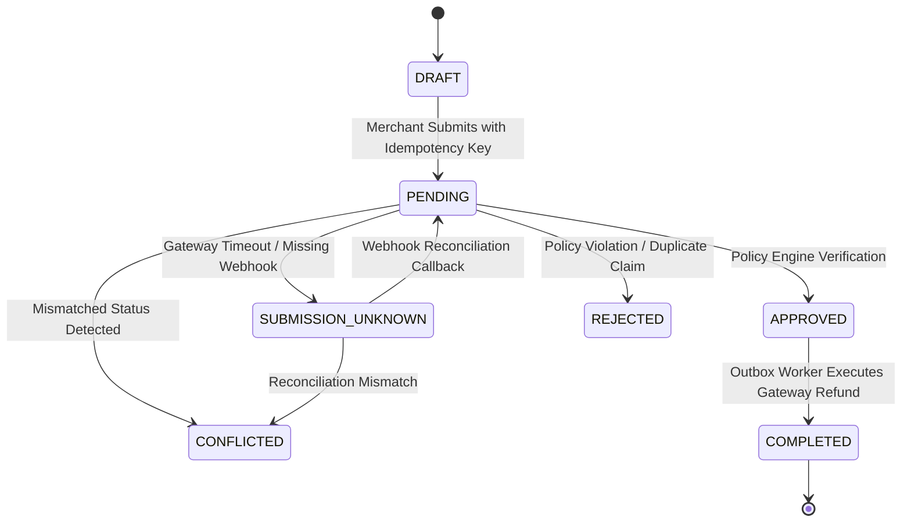

# 🛡️ Vyapaar Kavach — System Architecture & Technical Specifications

> **Resilient & Privacy-Preserving Exception Resolution for India's Decentralized Commerce (ONDC & Beyond)**

---

## 1. System Overview

Small merchants in India are rapidly digitizing on decentralized networks like ONDC and UPI. However, they face significant operational friction from chaotic post-transaction exceptions:
- **Delayed & Out-of-Order Webhooks**: Payment gateways and decentralized network nodes dispatch status callbacks asynchronously, leading to false negatives and double refund payouts.
- **Unstructured Messaging Claims**: Customers submit disputes via WhatsApp, Telegram, or SMS in vernacular Hinglish/Hindi, forcing manual human data entry.
- **Strict Privacy Regulations (DPDP Act 2023)**: Merchant platforms cannot centralize raw customer PII or transaction amounts into shared fraud databases.
- **Syndicated Fraud Networks**: Coordinated fraud rings exploit isolated merchants who lack privacy-safe mechanisms to pool risk signals.

**Vyapaar Kavach** solves this via five pillars:
1. **Deterministic State Machine (`EXCEPTIONS_V1`)**: Eliminates state ambiguity (`SUBMISSION_UNKNOWN`, `CONFLICTED`) with formal transition guards and idempotency locks.
2. **On-Device Edge SLM**: Runs quantized Small Language Models directly in the client browser / edge device using ONNX WebAssembly. Raw customer chat NEVER leaves the merchant device; only sanitized intent vectors hit the API.
3. **Transactional Outbox Engine**: Database-backed asynchronous queue with atomic lease locks (`SKIP LOCKED` equivalent) preventing double refunds even under network partitions.
4. **Groth16 Zero-Knowledge SNARK Syndication**: Mathematically proves anomalous dispute velocity and merchant-cluster risk to peer merchants without disclosing merchant identity, customer PII, or financial volume.
5. **Cryptographic Governance Audit Trail**: Append-only log with SHA-256 rolling hash chains for tax compliance, bank chargeback defense, and ONDC dispute mediation.

---

## 2. Component Topology

```
┌────────────────────────────────────────────────────────────────────────┐
│                        MERCHANT CLIENT (EDGE)                          │
│                                                                        │
│  [WhatsApp / SMS / Chat Claim]                                         │
│                │                                                       │
│                ▼                                                       │
│   ┌───────────────────────────┐                                        │
│   │   ONNX WebAssembly SLM    │ ◄── Device-Local Execution             │
│   │ (Hinglish/English Parser) │     (Zero PII sent across network)     │
│   └─────────────┬─────────────┘                                        │
│                 │ Extracted Intent, Amount, Reference (DPDP Compliant) │
└─────────────────┼──────────────────────────────────────────────────────┘
                  │ HTTPS / TLS 1.3
                  ▼
┌────────────────────────────────────────────────────────────────────────┐
│                    VYAPAAR KAVACH BACKEND (FASTAPI)                    │
│                                                                        │
│  ┌──────────────────────────┐     ┌──────────────────────────────────┐ │
│  │ vyapaar_disputes.py      │     │ vyapaar_outbox.py                │ │
│  │ (Deterministic Engine)   │     │ (Transactional Outbox Worker)    │ │
│  └────────────┬─────────────┘     └─────────────────┬────────────────┘ │
│               │                                     │                  │
│  ┌────────────┴─────────────┐     ┌─────────────────┴────────────────┐ │
│  │ vyapaar_zk.py            │     │ vyapaar_audit.py                 │ │
│  │ (Groth16 ZK Prover)      │     │ (SHA-256 Tamper-Evident Export)  │ │
│  └────────────┬─────────────┘     └─────────────────┬────────────────┘ │
│               └───────────────────┬─────────────────┘                  │
│                                   ▼                                    │
│                     ┌───────────────────────────┐                      │
│                     │  SQLite (WAL) / Postgres  │                      │
│                     │  Atomic Lease & Idempot.  │                      │
│                     └───────────────────────────┘                      │
└────────────────────────────────────────────────────────────────────────┘
                  │
        ┌─────────┴─────────┐
        ▼                   ▼
 [ONDC Beckn Network]   [Payment Gateway / Bank]
 (ZK Fraud Signal)      (Reconciliation Webhook)
```

---

## 3. The EXCEPTIONS_V1 State Machine

To prevent double payouts during webhook delays, payments and refund intents follow a formal, non-bypassable state matrix.



### State Definitions:
- **`SUBMISSION_UNKNOWN`**: Webhook has not arrived. Funds are **HARD LOCKED**. No duplicate refund can be initiated until a gateway reconciliation signal or webhook arrives.
- **`CONFLICTED`**: Multiple conflicting states observed across gateway and network logs. Requires merchant cryptographic sign-off.
- **`APPROVED`**: Deterministically validated; queued for outbox execution.
- **`COMPLETED`**: Gateway acknowledged payout. Terminal state.

---

## 4. Edge SLM & Privacy Architecture

- **Quantized Model**: `onnx-slm-vyapaar-v1-quantized-int8` running in WebAssembly.
- **Vernacular Support**: Recognizes Hindi/Hinglish phrasing (e.g. *"paise wapas do"*, *"do baar cut gaya"*, *"order nahi mila"*), UPI IDs, RRN numbers, and rupee values.
- **DPDP Act (2023) Compliance**:
  - The customer's mobile number is irreversibly hashed using SHA-256 with merchant-scoped salt before insertion.
  - Raw conversation text is discarded at the browser layer; only `{intent, amount_paise, ref_id, urgency}` are transmitted.

---

## 5. Transactional Outbox Pattern & Lease Locking

Direct synchronous calls to external payment APIs inside request handlers cause race conditions and partial failures. Vyapaar Kavach implements the Transactional Outbox:

1. **Atomic Insertion**: When a refund is approved, the `refund_intents` status and an `outbox_jobs` row are committed in the **same database transaction**.
2. **Deterministic Leasing**:
   ```sql
   UPDATE outbox_jobs
   SET status = 'LEASED', lease_id = ?, lease_expires_at = datetime('now', '+30 seconds')
   WHERE status = 'PENDING' AND (lease_expires_at IS NULL OR lease_expires_at < datetime('now'))
   LIMIT 10;
   ```
3. **Lease Expiry Guard**: If a worker node crashes mid-execution, the lease expires after 30 seconds and another node picks up the task.
4. **Dead Letter Queue (DLQ)**: Jobs failing more than 3 times transition to `DEAD_LETTER` with root-cause telemetry recorded in `governance_audit_logs`.

---

## 6. Groth16 Zero-Knowledge Fraud Syndication

When a merchant detects a coordinated dispute spike, they syndicate this intelligence across ONDC without revealing customer identities or transaction amounts.

- **Proving System**: Groth16 over `BN128` (alt_bn128) elliptic curve.
- **Private Inputs (Witness)**:
  - Merchant UUID
  - Customer transaction list
  - Individual dispute values
- **Public Signals (Broadcasted)**:
  - Dispute anomaly score ($S \in [0.0, 1.0]$)
  - Cluster size (e.g. 5 nodes)
  - Dispute velocity (e.g. 8 disputes / hr)
  - Proof vector $\pi = (\pi_A, \pi_B, \pi_C) \in \mathbb{G}_1 \times \mathbb{G}_2 \times \mathbb{G}_1$ (192 bytes)
- **Peer Verification**: Peer nodes verify the pairing equation $e(\pi_A, \pi_B) = e(\alpha, \beta) \cdot e(x \cdot \gamma, \delta) \cdot e(\pi_C, \delta)$ in $<15\text{ ms}$.

---

## 7. Cryptographic Governance Audit Trail

Every state mutation generates an audit log entry:
$$\text{Hash}_n = \text{SHA256}(\text{Hash}_{n-1} \parallel \text{Event Payload} \parallel \text{Timestamp})$$
- Exports provide cryptographic root hashes for ONDC network mediators, bank reconciliations, and tax auditors.
